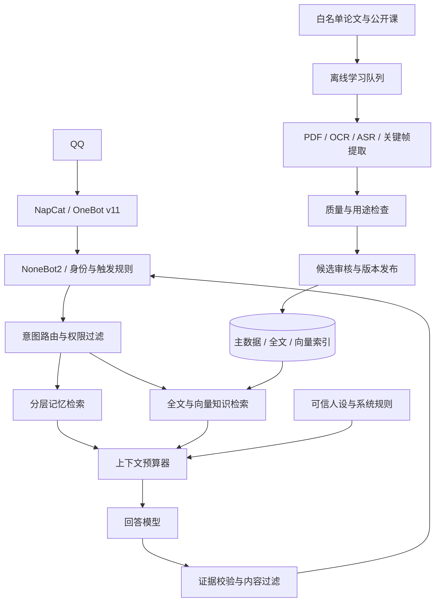

# QQBot 自主学习与分层长期记忆架构

面向 **NapCat + NoneBot2** 的 QQBot 开发方案：围绕数学与 AI 科技构建受控学习流程，兼顾音乐、绘画和健康幽默，通过分层记忆与按需 RAG 控制上下文成本。

> 当前为架构与开发规格仓库，尚未提供可直接运行的 QQBot 实现。配置是待实现接口的模板，性能参数是参考初值。

## 文档入口

- [完整开发方案：17 章](docs/development-plan.md)
- [分阶段实施与验收](docs/roadmap.md)
- [配置与数据结构模板](examples/README.md)

## 核心能力设计

- 分层记忆：工作上下文、会话状态、用户偏好、情景记忆、外部语义知识与冷存储。
- 按需检索：权限过滤、结构化查询、全文与向量混合召回、可选重排、固定 token 预算。
- 受控自主学习：来源白名单、领域配额、候选区、审核发布、增量更新与撤销。
- 多模态摄取：论文、公开课、字幕、OCR、ASR、公式、图表与关键帧定位。
- 人格表达：可信人设、场景风格、幽默理解、入库与输出双重过滤。
- 资源管理：在线回复与离线学习分离，支持 WSL2 / WSL Containers 的部署取舍。
- 可治理数据：私聊与群聊隔离、授权、纠正、遗忘、删除传播、备份恢复与评测。

## 总体架构

## 建议实施顺序

1. 统一回复入口，建立权限、授权、token 预算和基线评测。
2. 实现可查看、可更正、可删除的原子记忆。
3. 闭环验证手动文档导入、混合检索、引用与版本发布。
4. 添加受控来源发现、学习队列和资源限额。
5. 接入课程多模态，再逐步优化人设与健康幽默。

## WSL 部署取舍

优先保留现有消息服务，把离线提取放入 WSL Containers，以小批量、单重型 GPU 任务和持久缓存降低资源竞争。普通 WSL2 与 WSL Containers 使用不同资源配置，详见[第 17 章](docs/development-plan.md#17-wsl2-与-wsl-containers-优化部署)。

## 阅读配置前

`learning.yaml` 和 `persona.yaml` 中的字段是拟定的应用接口；需由项目实现解析和校验。`napcat-connection.json` 是连接字段示意，不能直接覆盖现有完整账户配置。`schema.sql` 是基础数据结构，不能代替完整生产迁移。

默认关闭自主采集与自动发布；替换启用模块中的占位符后再测试。数据库、私聊记录、媒体原件、模型权重和密钥不属于本仓库内容。

## 资料来源与使用边界

方案引用的官方资料列于[文档第 16 章](docs/development-plan.md#16-官方资料与核对记录)及第 17 章。外部论文、课程、图片、音视频和模型遵循各自许可；仓库公开不改变第三方内容的权利与用途限制。本仓库不包含上述第三方素材全文或模型权重。
